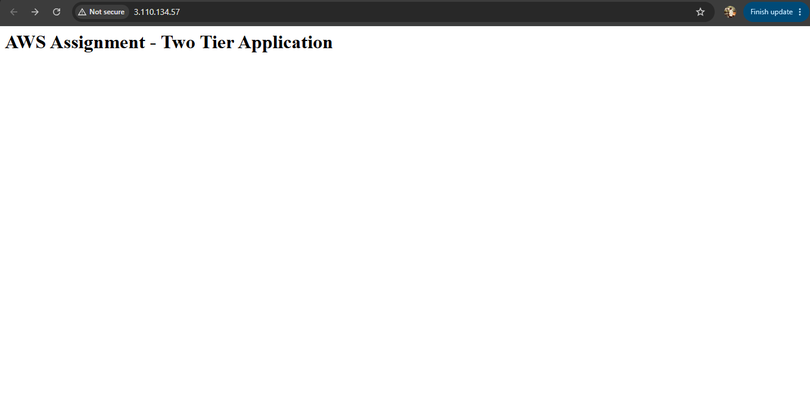
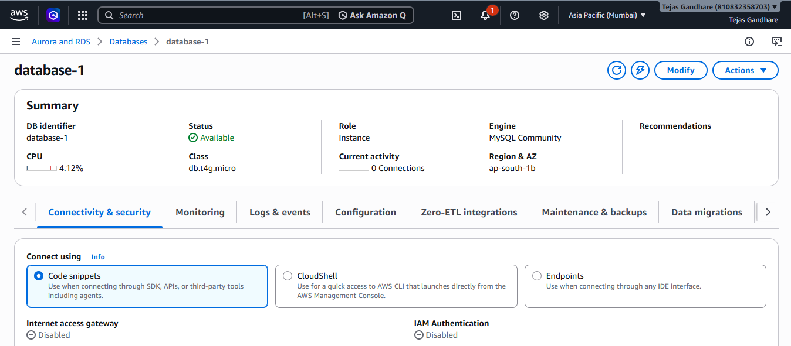
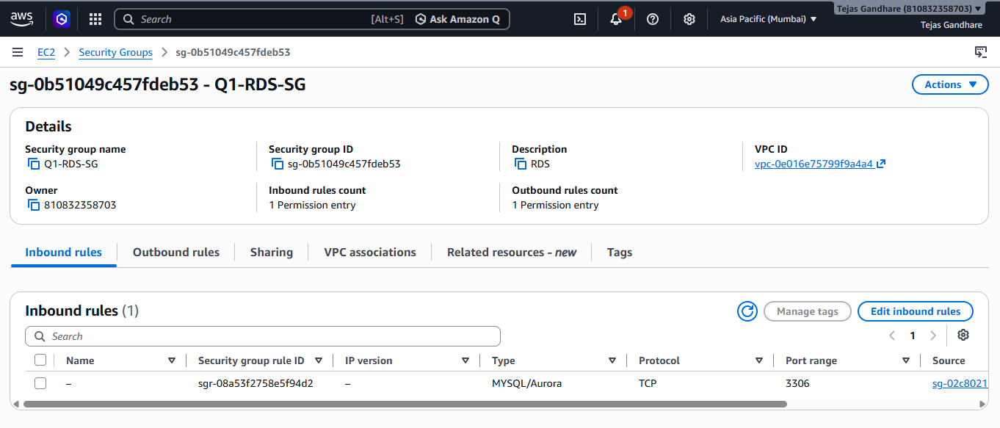
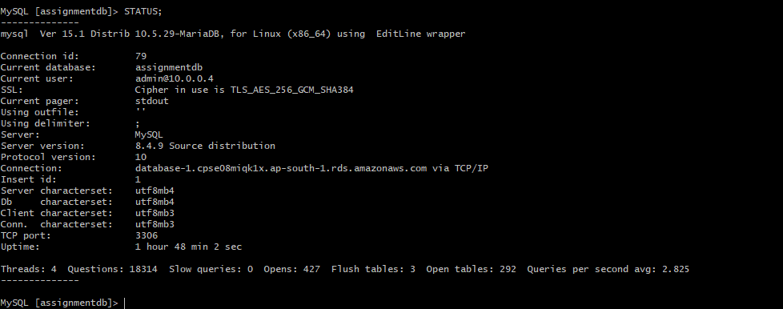
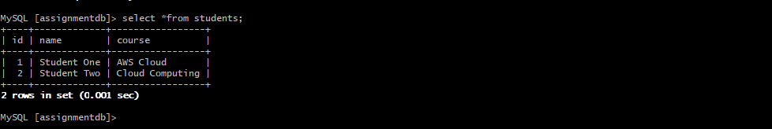
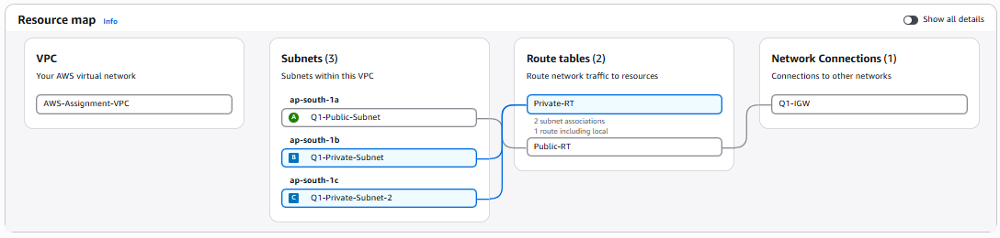
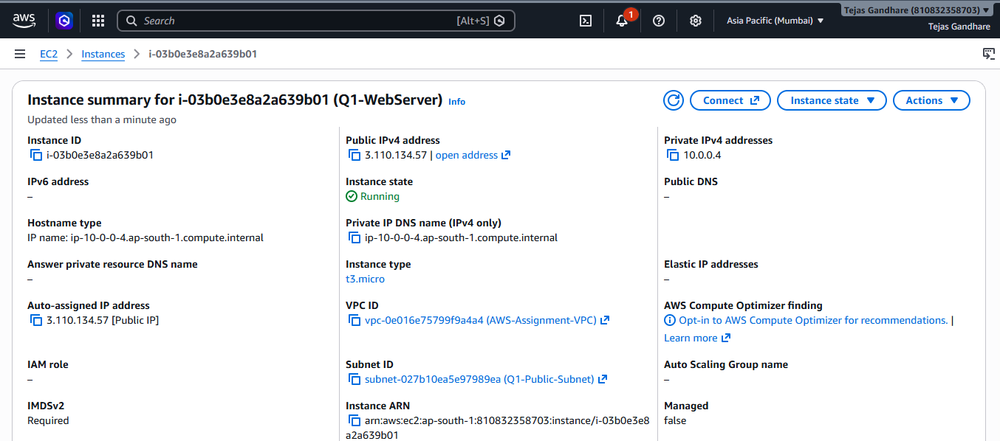

# AWS Q1 – EC2 Web Server + Amazon RDS

## 1. Objective

The objective of this project is to deploy a secure two-tier application on AWS using:

- Amazon VPC
- Amazon EC2
- Amazon RDS for MySQL
- Security Groups
- Nginx Web Server

The EC2 instance acts as the web server, while Amazon RDS is used as the managed database server.

The EC2 instance connects to the RDS MySQL database securely over port 3306.

---

## 2. AWS Services Used

| AWS Service | Purpose |
|---|---|
| Amazon VPC | Provides isolated network infrastructure |
| Amazon EC2 | Hosts the web server |
| Amazon RDS | Hosts the MySQL database |
| Security Groups | Controls inbound and outbound traffic |
| Internet Gateway | Provides internet connectivity to the public subnet |
| Nginx | Web server running on EC2 |

---

## 3. Architecture

```text
                    Internet
                       |
                Internet Gateway
                       |
                Public Subnet
                       |
                  Amazon EC2
                Nginx Web Server
                       |
                       | MySQL / TCP 3306
                       |
                Private Network
                       |
                 Amazon RDS
                  MySQL DB
```

The web server is hosted on EC2, while the database is hosted separately on Amazon RDS.

---

## 4. EC2 Web Server

An Amazon Linux EC2 instance was launched to host the web application.

Nginx was installed and configured on the EC2 instance.

The default Nginx page was replaced with a custom assignment page:

```bash
echo "<h1>AWS Assignment - Two Tier Application</h1>" | sudo tee /usr/share/nginx/html/index.html

sudo systemctl restart nginx
sudo systemctl enable nginx
```

The web server was then accessed through the EC2 public IP address.

### Expected Result

```text
AWS Assignment - Two Tier Application
```

### Screenshot Evidence

> Replace the filename below with your actual screenshot filename if different.



---

## 5. RDS MySQL Database

An Amazon RDS MySQL database was created for the application.

### Database Configuration

- Database Engine: MySQL
- Database Name: `assignmentdb`
- Master Username: `admin`
- Port: `3306`
- Region: `ap-south-1` (Mumbai)
- Public Access: Disabled

The RDS database is accessed from the EC2 instance rather than directly from the public internet.

### Screenshot Evidence



---

## 6. Security Groups

Security Groups were configured to restrict access between the web server and database.

### EC2 Security Group

| Protocol | Port | Source | Purpose |
|---|---:|---|---|
| SSH | 22 | My IP | Administrative access |
| HTTP | 80 | 0.0.0.0/0 | Web server access |

### RDS Security Group

| Protocol | Port | Source | Purpose |
|---|---:|---|---|
| MySQL | 3306 | EC2 Security Group | Database access from EC2 |

Port 3306 is not exposed to the entire internet.

### Screenshot Evidence



---

## 7. EC2 to RDS Connection

The EC2 instance was connected to the RDS MySQL database using the RDS endpoint.

The MariaDB client installed on Amazon Linux was used.

Client version:

```text
MariaDB 10.5.29
```

The AWS RDS CA certificate bundle was downloaded:

```bash
curl -o global-bundle.pem https://truststore.pki.rds.amazonaws.com/global/global-bundle.pem
```

The database was accessed using an SSL-enabled connection:

```bash
mysql -h database-1.cpse08miqk1x.ap-south-1.rds.amazonaws.com \
-P 3306 \
-u admin \
-p \
--ssl-ca=./global-bundle.pem \
--ssl-verify-server-cert
```

The connection was successful.

### SSL Verification

The following command was used to verify the database connection:

```sql
STATUS;
```

The SSL information was checked to confirm that encryption was being used.

### Screenshot Evidence



---

## 8. Database Configuration

After connecting to RDS, the database was created:

```sql
CREATE DATABASE assignmentdb;
USE assignmentdb;
```

A `students` table was created:

```sql
CREATE TABLE students (
    id INT AUTO_INCREMENT PRIMARY KEY,
    name VARCHAR(100),
    course VARCHAR(100)
);
```

Sample records were inserted:

```sql
INSERT INTO students (name, course)
VALUES
('Student One', 'AWS Cloud'),
('Student Two', 'Cloud Computing');
```

The records were verified using:

```sql
SELECT * FROM students;
```

### Result

```text
+----+-------------+-----------------+
| id | name        | course          |
+----+-------------+-----------------+
|  1 | Student One | AWS Cloud       |
|  2 | Student Two | Cloud Computing |
+----+-------------+-----------------+
```

This confirms that the EC2 instance successfully connected to Amazon RDS and performed database operations.

### Screenshot Evidence



---

## 9. Security Implementation

The following security practices were implemented:

- EC2 and RDS were deployed within the AWS VPC.
- SSH access was restricted to the administrator's IP address.
- HTTP access was allowed for the web server.
- RDS MySQL port 3306 was restricted to the EC2 security group.
- RDS was not exposed directly to the public internet.
- SSL/TLS was used for the EC2-to-RDS database connection.
- Database credentials were not stored in this repository.

---

## 10. Screenshot Evidence

All screenshots for Question 1 are stored in the `screenshots/` directory.

### Q1-1 — VPC



Shows the VPC configuration used for the two-tier application.

### Q1-2 — EC2 Instance



Shows the running Amazon Linux EC2 instance and its network details.

### Q1-3 — EC2 Web Server


Shows the custom Nginx web page.

### Q1-4 — RDS Database


Shows the RDS MySQL database configuration.

### Q1-5 — RDS Security Group


Shows the MySQL 3306 rule allowing access from the EC2 security group.

### Q1-6 — EC2 to RDS Connection


Shows the successful EC2-to-RDS connection and SSL verification.

### Q1-7 — Database Verification


Shows the `students` table and successfully retrieved records.

---

## 11. Verification

The following components were successfully verified:

- [x] EC2 instance running Amazon Linux
- [x] Nginx web server running
- [x] Custom web page accessible
- [x] Amazon RDS MySQL database available
- [x] EC2-to-RDS connectivity
- [x] Secure database connection using SSL
- [x] Database created successfully
- [x] Table created successfully
- [x] Records inserted successfully
- [x] Records retrieved successfully

---

## 12. Conclusion

A secure two-tier AWS application was successfully implemented using Amazon EC2 and Amazon RDS.

The EC2 instance hosts the Nginx web server, while Amazon RDS provides the MySQL database. Security Groups restrict database access to the EC2 instance, and the database connection is protected using SSL/TLS.

The successful database query confirms communication between the EC2 web server and the RDS database.
